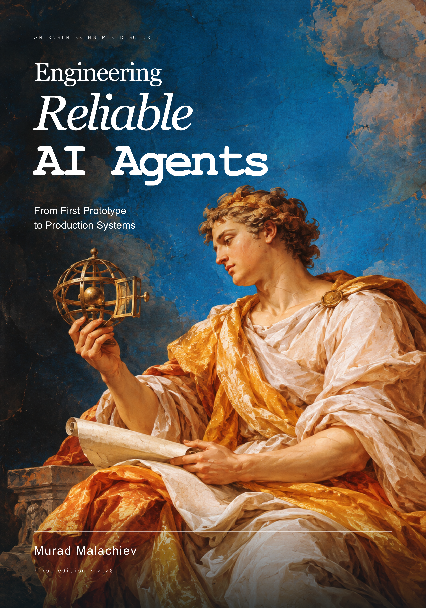

# Engineering Reliable AI Agents

**From First Prototype to Production Systems**  
**Murad Malachiev · First edition, September 2026**

A practical book about building AI agents whose actions are bounded, verifiable, and recoverable. The 216-page edition follows a fictional support agent from a first prototype through tool design, evidence, memory, evaluation, security, human supervision, and production operation.

<p></p>

## Read the book

- [Download the PDF](https://github.com/hitrich/engineering-reliable-ai-agents/releases/latest/download/engineering-reliable-ai-agents.pdf)
- [Download the complete offline edition](https://github.com/hitrich/engineering-reliable-ai-agents/releases/latest/download/murad-malachiev-engineering-reliable-ai-agents.zip)
- [Read the Markdown edition](engineering-reliable-ai-agents.md)
- [Browse the companion guide](companion/README.md)

The book contains 16 chapters, 51 tables, six technical diagrams, two interior paintings, three technical appendices, and references. The HTML edition includes chapter navigation and an interactive companion with diagrams, calculators, and a supervision demonstration.

## Run the companion

Python **3.11 or newer** on macOS or Linux. All Python examples use the standard library; no package installation is required. The MCP integration check uses POSIX pipe polling.

```bash
git clone https://github.com/hitrich/engineering-reliable-ai-agents.git
cd engineering-reliable-ai-agents/companion
python3 test_northstar.py
python3 test_mcp.py
python3 summarize_trials.py --check
python3 northstar.py demo --db /tmp/northstar-demo.db
```

Use a fresh database path for each clean demo. The demo pauses at `needs_approval` and leaves the ticket `OPEN`; Appendix A explains review and commit. See the [companion README](companion/README.md) for the optional live-model adapter, scenario generation, and implementation boundaries.

## Read the interactive edition locally

From the repository root:

```bash
python3 -m http.server 8000 --bind 127.0.0.1
```

Open [the book](http://127.0.0.1:8000/engineering-reliable-ai-agents.html) or [the interactive explorer](http://127.0.0.1:8000/agent-explorer.html). Keep the `book-assets` folder alongside the HTML files. The PDF is independently readable.

## What is included

| Path | Contents |
| --- | --- |
| `engineering-reliable-ai-agents.pdf` | Complete illustrated book |
| `engineering-reliable-ai-agents.md` | Readable book source |
| `engineering-reliable-ai-agents.html` | Browser edition |
| `agent-explorer.html` | Six diagrams, two calculators, and a supervision demonstration |
| `book-assets/` | Cover artwork, interior paintings, SVG diagrams, and explicit diagram models |
| `companion/` | Northstar implementation, tests, 200 scenario specifications, and usage guides |
| `cover.png` | Finished cover with title and author |

## Evidence and scope

Northstar, its companies, records, and policies are fictional teaching material. The companion has 29 deterministic component checks, plus separate MCP transport and summary-arithmetic checks. Its 200 scenario specifications form 40 task families: 120 development cases and 80 held-out cases. They are specifications, not results from 200 executed agent trials. No live-model benchmark, human study, or production deployment is claimed.

GitHub Actions runs the offline checks. No API key is needed for them. Keep credentials and private customer data out of issues and commits.

## Corrections

Report corrections through [GitHub Issues](https://github.com/hitrich/engineering-reliable-ai-agents/issues). Include the edition, chapter or file, expected and observed behavior, and a minimal reproduction where applicable. See [the correction guide](companion/ERRATA.md) and [chapter checkpoints](companion/CHAPTER-CHECKPOINTS.md).

## Copyright

Copyright © 2026 Murad Malachiev. No additional open-source or Creative Commons license is granted in this repository. The source books referenced by the bibliography are not included.
